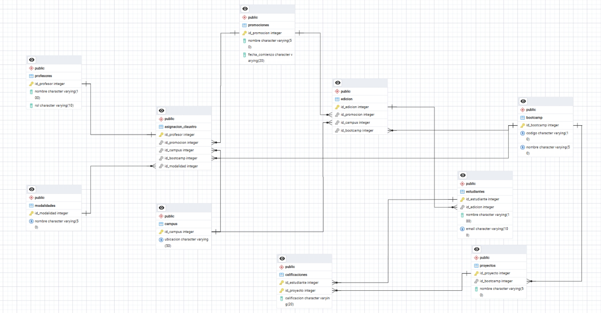

# alumnos_BBDD
alumnos_BBDD



## Modelo Entidad-Relación (E/R)

* CAMPUS (1 a N) EDICION: Un campus alberga muchas ediciones; una edición ocurre en un único campus.
* PROMOCIONES (1 a N) EDICION: Una promoción (convocatoria) tiene varias ediciones; una edición pertenece a una promoción.
* BOOTCAMP (1 a N) EDICION: Un bootcamp (DS o FS) se imparte en varias ediciones; cada edición corresponde a un bootcamp.
* EDICION (1 a N) ESTUDIANTES: En una edición se matriculan muchos estudiantes; cada estudiante pertenece a una edición.
* BOOTCAMP (1 a N) PROYECTOS: Cada bootcamp consta de varios proyectos específicos (5 en DS, 5 en FS); cada proyecto pertenece a un bootcamp.
* ESTUDIANTES (N a M) PROYECTOS: Un estudiante realiza varios proyectos y cada proyecto es realizado por muchos estudiantes. De esta relación surge el atributo calificación (Apto / No Apto).
* PROFESORES (1 a 1) ASIGNACION_CLAUSTRO: Cada profesor tiene una asignación específica vinculada a un campus (1:N), una promoción (1:N), un bootcamp (1:N) y una modalidad (1:N).

## Modelo Lógico de la Base de Datos

La base de datos está normalizada en **Tercera Forma Normal (3FN)** y consta de **10 tablas**:

| Tabla | Clave Primaria (PK) | Claves Foráneas (FK) | Descripción |
| :--- | :--- | :--- | :--- |
| **`campus`** | `id_campus` | — | Sedes físicas de la escuela (Madrid, Valencia). |
| **`bootcamp`** | `id_bootcamp` | — | Programas formativos (Data Science, Full Stack). |
| **`modalidades`** | `id_modalidad` | — | Modalidades de impartición (Presencial, Online). |
| **`promociones`** | `id_promocion` | — | Convocatorias y fechas de inicio. |
| **`profesores`** | `id_profesor` | — | Claustro docente y roles (`TA`, `LI`). |
| **`proyectos`** | `id_proyecto` | `id_bootcamp` | Catálogo de los 5 proyectos evaluables por bootcamp. |
| **`edicion`** | `id_edicion` | `id_promocion`, `id_campus`, `id_bootcamp` | Instancia concreta de un bootcamp en un campus y fecha. |
| **`estudiantes`** | `id_estudiante` | `id_edicion` | Alumnos matriculados y su correo electrónico único. |
| **`asignacion_claustro`** | `id_profesor` | `id_promocion`, `id_campus`, `id_bootcamp`, `id_modalidad` | Asignación de cada docente a su edición y modalidad. |
| **`calificaciones`** | `(id_estudiante, id_proyecto)` | `id_estudiante`, `id_proyecto` | Resultados (`Apto` / `No Apto`) de cada alumno por proyecto. |


```text
  [CAMPUS] ────────(1:N)────────┐
                                 ▼
  [PROMOCIONES] ───(1:N)───► [EDICION] ◄───(1:N)─── [BOOTCAMP]
                                 │                       │
                               (1:N)                   (1:N)
                                 ▼                       ▼
  [MODALIDADES] ───(1:N)───► [ESTUDIANTES]           [PROYECTOS]
                                 │                       │
                                 └──────► (N:M) ◄────────┘
                                     [calificaciones]

  [PROFESORES] ────(1:1)───► [ASIGNACION_CLAUSTRO]
                                 ▲   ▲   ▲   ▲
       ┌─────────────────────────┘   │   │   └─────────────────────────┐
     (1:N)                         (1:N) (1:N)                       (1:N)
  [CAMPUS]                 [PROMOCIONES] [BOOTCAMP]              [MODALIDADES]
```

1. campus: 
    * id_campus (PK)
    * ubicacion (Madrid, Valencia, etc)
2. bootcamp: (renombrado de vertical)
    * id_bootcamp (PK)
    * codigo (DS, FS) para Data Science, Full Stack, etc
    * nombre (Data Science, Full Stack)
3. modalidades: 
    * id_modalidad (PK)
    * nombre (Presencial, Online)
4. promociones: 
    * id_promocion (PK)
    * nombre (Septiembre, Febrero)
    * fecha_comienzo
5. edicion (grupos_clase, la oferta académica concreta)  
    * id_edicion (PK)
    * id_promocion (FK) (id de Septiembre o Febrero)
    * id_campus (FK) (id de Madrid, Valencia,)
    * id_bootcamp (FK) (id de Data Science, Full Stack)
6. estudiantes: 
    * id_estudiante (PK)
    * id_edicion (FK)
    * nombre
    * email (UNIQUE)
7. profesores: (renombrado del antiguo claustro) 
    * id_profesor (PK)
    * nombre
    * rol (TA, LI) para Teacher Asistant, Leader Instructor, etc 
8. asignacion_claustro: Relación N:M entre profesores y ediciones 
    * id_profesor (PK)
    * id_promocion (FK)	
    * id_campus	(FK)
    * id_bootcamp (FK)	
    * id_modalidad (FK)
9. proyectos: Catálogo de proyectos por bootcamp
    * id_proyecto (PK)
    * id_bootcamp (FK)
    * nombre (HLF, EDA, WebDev...)
10. calificaciones: Relación N:M entre estudiantes y proyectos 
    * id_estudiante (FK)
    * id_proyecto (FK)
    * calificacion (BOOLEAN o VARCHAR)
      

## Arquitectura y Tecnologías

* **Python 3**: Procesamiento y limpieza de datos (`pandas`, `numpy`).
* **PostgreSQL**: Sistema gestor de base de datos relacional.
* **SQLAlchemy & Psycopg2**: Conexión, creación de esquema e ingesta de datos desde Jupyter Notebook.
* **pgAdmin 4**: Administración visual y validación de integridad referencial.
* **Render**: Alojamiento cloud de la instancia PostgreSQL en producción.


---
